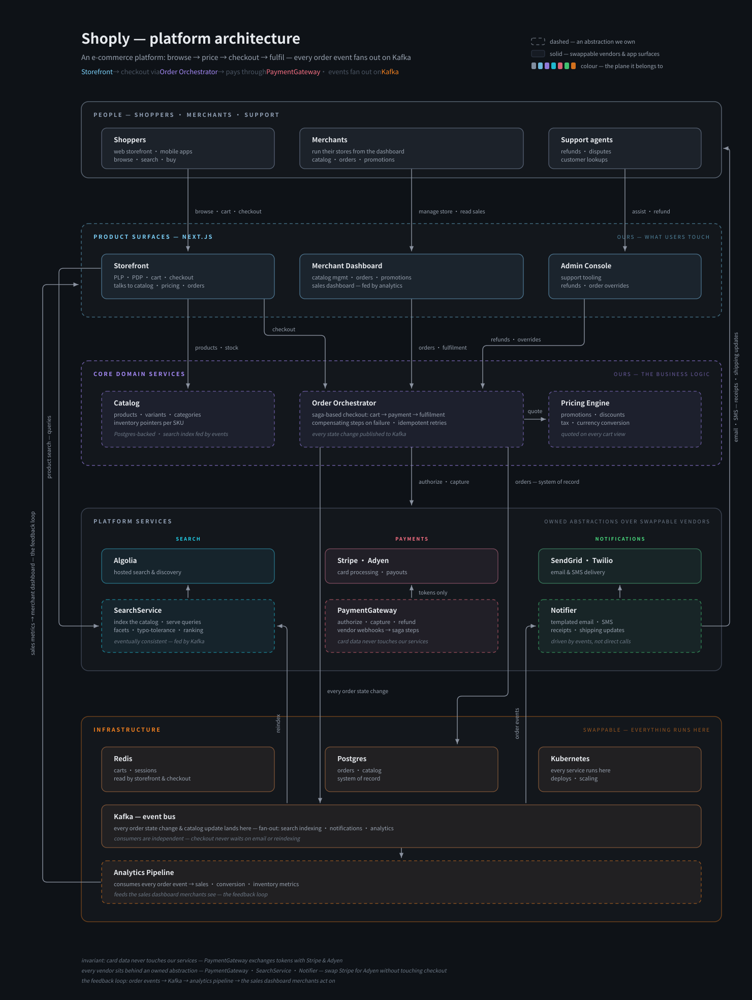
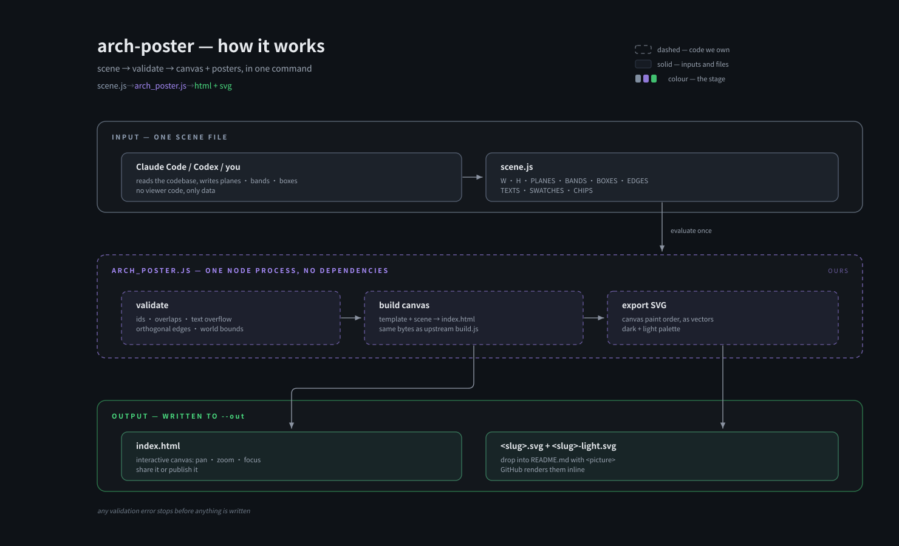
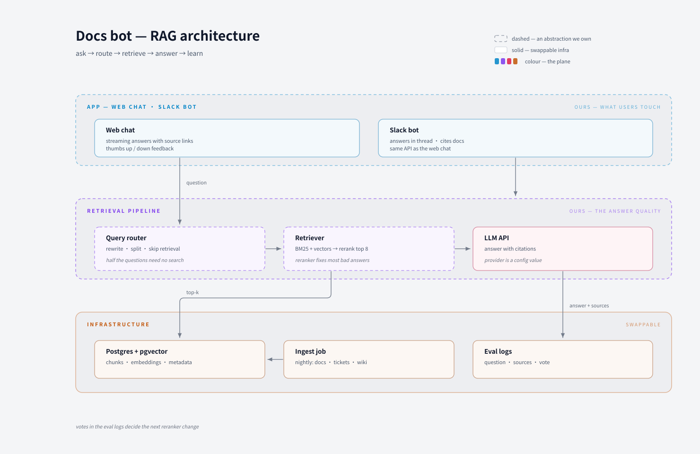
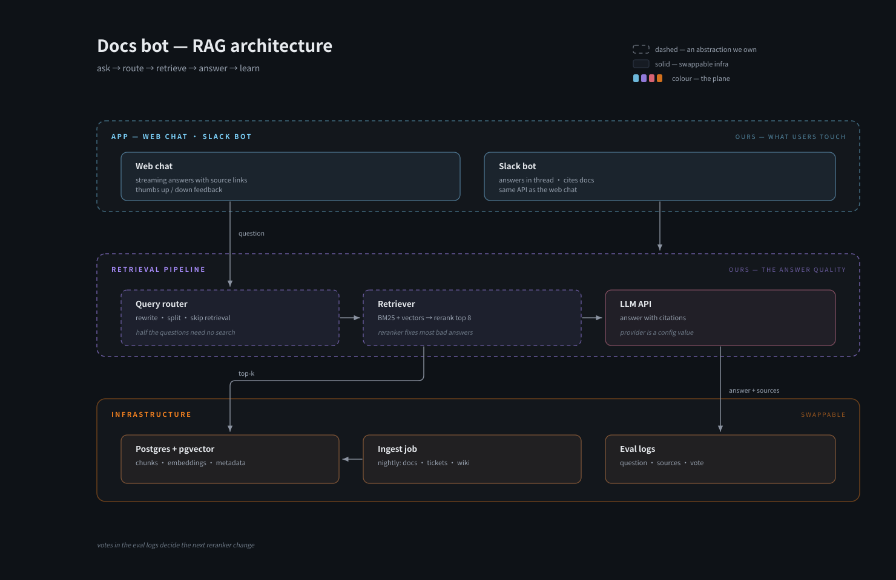
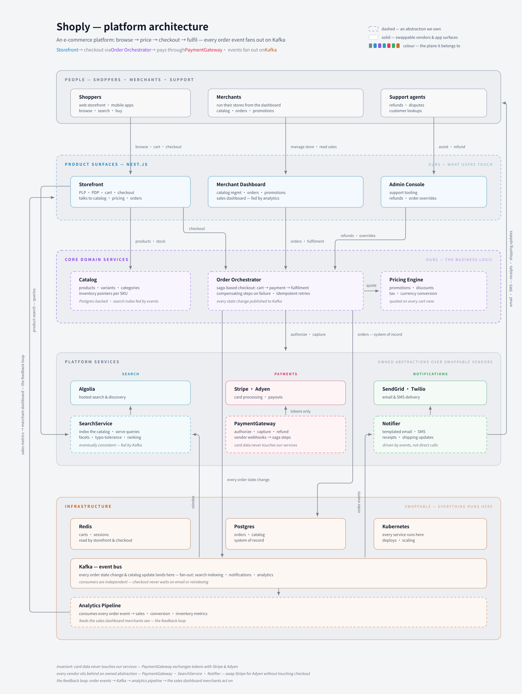
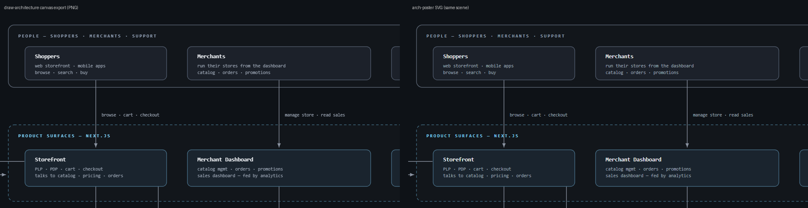

<div align="center">

# arch-poster

**Get an architecture diagram you can pan and zoom, plus the same picture as an SVG your README can show.**

GitHub cannot show an interactive HTML canvas in a README. arch-poster turns one [draw-architecture](https://github.com/yulonghe97/draw-architecture) scene file into both: the interactive canvas and dark/light SVG posters, in one command.

Works with **Claude Code** and **Codex**.

 

<picture>
  <source media="(prefers-color-scheme: light)" srcset="docs/shoply-light.svg">
  
</picture>

<sub>The image above is the real output of the Quick start command below, committed unchanged.</sub>

</div>

## Quick start
```bash
git clone https://github.com/Dodai0419/arch-poster && cd arch-poster
node arch_poster.js examples/shoply-scene.js --title "Shoply — platform architecture" --slug shoply --out out
```
```
5 bands · 20 boxes · 20 edges · 0 errors · 0 warnings
wrote out/index.html (53727 bytes)
wrote out/shoply.svg (23711 bytes)
wrote out/shoply-light.svg (23696 bytes)
```
Open `out/index.html` in a browser for the interactive canvas. Put the SVGs in your README:

```html
<picture>
  <source media="(prefers-color-scheme: light)" srcset="docs/shoply-light.svg">
  
</picture>
```

Node 18+ only. No `npm install`, no dependencies.

## Gallery

Every image below is a committed output of `arch_poster.js` on a file in `examples/`.

### This tool, drawn by itself
`node arch_poster.js examples/arch-poster-scene.js --title "arch-poster — how it works" --slug how-it-works --out docs`



### A RAG docs bot, light theme
`node arch_poster.js examples/rag-scene.js --title "Docs bot — RAG architecture" --slug rag --out docs`



### The same RAG bot, dark theme


### Shoply, light theme (the upstream example scene)


### Canvas vs SVG, side by side
Left: draw-architecture's own PNG export of its canvas. Right: arch-poster's SVG of the same scene, screenshotted in Chrome.



## The problem
- draw-architecture makes a great interactive canvas, but it is one HTML file with JavaScript. A GitHub README cannot embed it, so the diagram never appears where people look first.
- Its PNG export is a click in the browser, at a fixed 2x size, and it goes stale every time the scene changes.
- Hand-writing an SVG diagram instead (the svg-diagram approach) means doing the layout math twice and keeping two drawings in sync.

## The solution
| Idea | Fixes |
|------|-------|
| **One scene, three files** | `index.html` (canvas), `<slug>.svg` (dark), `<slug>-light.svg` (light) come from the same data, so they can not drift apart |
| **Same canvas, byte for byte** | The HTML is spliced exactly like upstream `build.js` (tested by sha256), so nothing about the interactive viewer changes |
| **Same validator, same messages** | The upstream `validate.js` checks run first, in the same process; any error stops before a file is written |
| **Canvas paint order, as vectors** | Bands, legend, edges with rounded elbows, arrowheads, boxes and labels are drawn in the same order and colours as the canvas |
| **Light theme from the template's own remap** | The light SVG uses draw-architecture's hand-tuned light palette, ready for `<picture>` |
| **CJK font fallback** | svg-diagram's font-stack rule, so Chinese, Japanese and Korean labels render on macOS, Windows and Linux |

## Use with Claude Code
```bash
/plugin marketplace add Dodai0419/arch-poster
/plugin install arch-poster@arch-poster
```
Then ask: *"Draw the architecture of this repo and put the poster in the README."* The skill tells the agent to write a scene, run `arch_poster.js`, fix every validation error, and embed the SVGs.

## Use with Codex (ChatGPT)
```bash
git clone https://github.com/Dodai0419/arch-poster && cp -r arch-poster/skills/* ~/.codex/skills/
```
Or copy `AGENTS.md` to your project root.

## Writing a scene
A scene is plain JavaScript data: `W, H, PLANES, BANDS, BOXES, EDGES, TEXTS, SWATCHES, CHIPS`. The format is draw-architecture's, unchanged; read [their scene-format guide](https://github.com/yulonghe97/draw-architecture/blob/main/references/scene-format.md) and copy one of `examples/`.

```js
const PLANES = { app: { c: '#7DD3FC', label: 'App' } };
const BOXES = [
  { id: 'web', plane: 'app', band: 'band-app', x: 200, y: 252, w: 560, h: 80, r: 10,
    name: 'Web chat', about: 'The chat page.',
    texts: [ ['bl', 224, 280, 'Web chat'], ['bs', 224, 302, 'streaming answers'] ] }
];
```

Options:

| Flag | Meaning |
|------|---------|
| `--title` | Page title, required unless `--check` |
| `--out` | Output folder, default `out` |
| `--slug` | SVG file name, default from the title |
| `--kicker`, `--sub` | Same as upstream `build.js` |
| `--check` | Validate only, write nothing (exit 1 on errors) |

## Benchmarks
Windows 11, Node v24.20.0, Chrome (headless) for rendering. Commands are in `tests/` and below.

| | draw-architecture (validate.js + build.js) | arch-poster |
|-|-|-|
| validate + build the Shoply scene, median of 10 (two sessions) | 297 ms, 384 ms (two node processes) | 181 ms, 214 ms (one process, also writes both SVGs) |
| validator report on the clean and a broken scene | reference | identical text (tested) |
| canvas `index.html` | reference | identical bytes, sha256 `91699fcc…` (tested) |
| README-ready SVG | none | dark + light |
| SVG vs canvas pixels, Shoply, same fallback font | reference (canvas PNG export at 1x) | 0.22% of pixels differ by more than 64/255 (text anti-aliasing only) |
| lines of code | 243 (build.js 44 + validate.js 199) | 306 (validate + build + SVG export in one file) |
| dependencies | 0 | 0 |

How the pixel check was done: the upstream HTML was built, its `exportPng()` was run at scale 1 in headless Chrome with the Google Fonts link removed (GitHub README images cannot load web fonts either), and compared with a Chrome screenshot of `shoply.svg` at 1480×1968. Shapes, lines and colours matched; the remaining differences are glyph edge anti-aliasing.

svg-diagram's `svg-lint`: all six SVGs in `docs/` have 0 findings for `font-stack`, `xml-escaping`, `arrow-marker` and `light-bg-fallback`. The other checks encode svg-diagram's own house style (its palette, box heights, text never over a box), which this style does not follow, so they are not claimed.

## Inspired by
- [yulonghe97/draw-architecture](https://github.com/yulonghe97/draw-architecture) — the scene format, the canvas template (shipped unchanged in `assets/`), the validator rules and the example scene.
- [bybit-exchange/svg-diagram](https://github.com/bybit-exchange/svg-diagram) — the idea that a diagram belongs in the README as an SVG, the CJK font-stack rule and the escaping rules, checked with its `svg-lint`.

## Roadmap
- [ ] `--png` output through a local headless browser, for places that do not accept SVG
- [ ] Highlight one box (the canvas focus state) in the SVG with `--focus <id>`
- [ ] Watch mode that rebuilds on scene changes

## License
MIT. Includes `assets/template.html` and `examples/shoply-scene.js` from draw-architecture (MIT, Copyright (c) 2026 Yulong He); see `LICENSE`.
